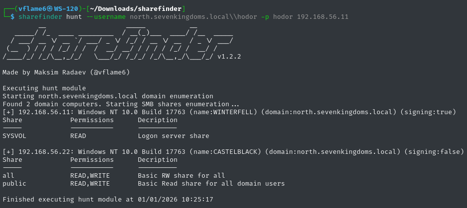

<h1 align="center">
  sharefinder
</h1>

<h4 align="center">Active network shares enumeration tool.</h4>

<p align="center">
<a href="https://goreportcard.com/report/github.com/vflame6/sharefinder" target="_blank"></a>
<a href="https://github.com/vflame6/sharefinder/issues"></a>
<a href="https://github.com/vflame6/sharefinder/releases"></a>
<a href="https://t.me/vflame6"></a>
</p>

Created by Maksim Radaev/[@vflame6](https://github.com/vflame6)

---

`sharefinder` is a network share discovery tool that enumerates shares, permissions and files in networks and domains.

Authenticated scans report the target Windows version and build. When the account has local admin rights, Sharefinder also tries to refine that into the exact product/build from the remote registry.

Authenticated scans also report SMB signing status and whether the supplied credentials have local admin rights on the target.

## Features



Main commands:

- `hunt`: hunt network shares inside an Active Directory domain, or across the forest with `--forest`
- `auth`: search for shares with specified credentials
- `guest`: search for shares accessible with guest authentication
- `null`: search for shares accessible by null session

You can check out a <a href="https://maksimradaev.com/download/sharefinder_demo_report.html" target="_blank">demo HTML report</a> generated by the tool.

## Usage

```shell
sharefinder -h
```

Here is the help menu for the tool.

```yaml
usage: sharefinder [<flags>] <command> [<args> ...]

sharefinder is a network share discovery tool that enumerates shares,
permissions and files in networks and domains.

Flags:
  -h, --[no-]help            Show context-sensitive help (also try --help-long
                             and --help-man).
      --[no-]debug           Enable debug mode, print debug messages
      --[no-]quiet           Enable quiet mode, print only results
  -o, --output=""            Filename to write output in raw format
      --output-xml=""        Filename to write XML formatted output
      --output-all=""        Filename to write output in all formats
      --[no-]html            Generate HTML report (requires XML output)
      --threads=10           Number of threads
      --timeout=5s           Seconds to wait for connection
      --io-timeout=30s       Abort an SMB or LDAP operation when the server
                             sends nothing for this long
      --smb-port=445         Target port of SMB service
      --proxy=""             SOCKS-proxy address to use for connection in format
                             IP:PORT
      --max-auth-failures=1  Stop the scan after this many rejected logons;
                             0 disables the guard
  -e, --exclude="IPC$,NETLOGON,ADMIN$,print$,C$"
                             Exclude list
      --exclude-hosts=""     Skip these targets: IPs, CIDRs, ranges, hostnames
                             (comma-separated) or a file
      --[no-]list            List readable shares
      --[no-]recurse         List readable shares recursively
      --depth=5              Maximum directory depth below the share root for
                             --recurse (0 lists the root only)
      --[no-]follow-links    Descend into directory symlinks and junctions
                             during --recurse
      --max-files=0          Stop listing a share after this many entries (0 =
                             no limit)
      --write-check=file     How to test write access: mask (open the share root
                             with write rights, creates nothing), file (create
                             and delete a temporary file) or off
      --[no-]version         Show application version.

Commands:
  help [<command>...]
  null <target>
  guest [<flags>] <target>
  auth --username=USERNAME [<flags>] <target>
  hunt --username=USERNAME [<flags>] <dc>
```

### Targets

A target is an IP address, a CIDR (`10.0.0.0/24`; `/31` and `/32` work), a
range (`10.0.0.1-50` or `10.0.0.1-10.0.0.50`), a hostname or FQDN, a
comma-separated list of those, or a file with one or more per line (`#` starts
a comment). Duplicates are scanned once. `--exclude-hosts` takes the same
syntax and keeps targets out of scope, also when a hostname resolves into an
excluded block.

### Safe defaults

- **Account lockout:** with a wrong password only one logon is sent; the scan
  stops after `--max-auth-failures` rejected logons (default 1). A server that
  maps a failed logon to its Guest account counts as a rejection, and every
  host line shows the session type it was scanned with (`user`, `guest`,
  `null`). Once the credentials have worked, hosts outside the account's
  domain (and every host with `--local-auth`) that refuse them are reported
  per host instead of stopping the scan.
- **Write check:** `--write-check file` (default) creates and deletes a random
  file in each disk share root. `--write-check mask` only opens the share root
  with write access rights and leaves nothing behind; `--write-check off` skips
  the check.
- **Recursion:** `--recurse` stops 5 levels below the share root (`--depth`),
  does not follow directory symlinks or junctions (`--follow-links`) and can be
  capped per share with `--max-files`.
- **Hung hosts and Ctrl+C:** every read and write is bounded by `--io-timeout`.
  Ctrl+C stops the scan within seconds and still writes the partial results;
  a second Ctrl+C exits at once.
- **LDAP:** `hunt` never sends a password in clear text: without LDAPS or
  StartTLS it binds with NTLM, and a simple bind over plain LDAP needs
  `--allow-plaintext-ldap`. A failed Kerberos bind does not fall back to a
  password bind.

## Installation

`sharefinder` requires **go1.25** or newer to install successfully.

```shell
go install -v github.com/vflame6/sharefinder@latest
```

Compiled versions are available on [Release Binaries](https://github.com/vflame6/sharefinder/releases) page.

Run the container image:

```shell
docker run --rm ghcr.io/vflame6/sharefinder -h
```

To Build:

```
go build -o sharefinder .
```

Build with Docker:

```shell
docker build -t sharefinder .
```

## Contributing

Feel free to open an issue if something does not work, or if you have any issues. New ideas to improve the tool are much appreciated. See [CONTRIBUTING.md](CONTRIBUTING.md) for the development workflow and [SECURITY.md](SECURITY.md) to report vulnerabilities.
